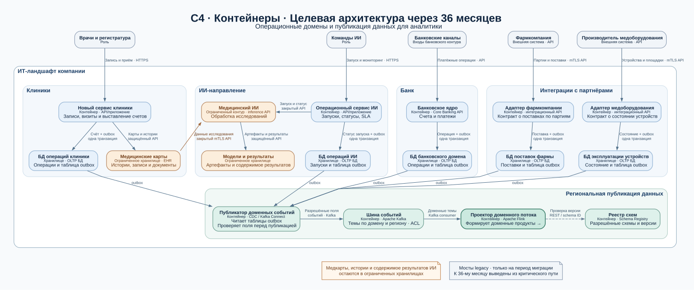
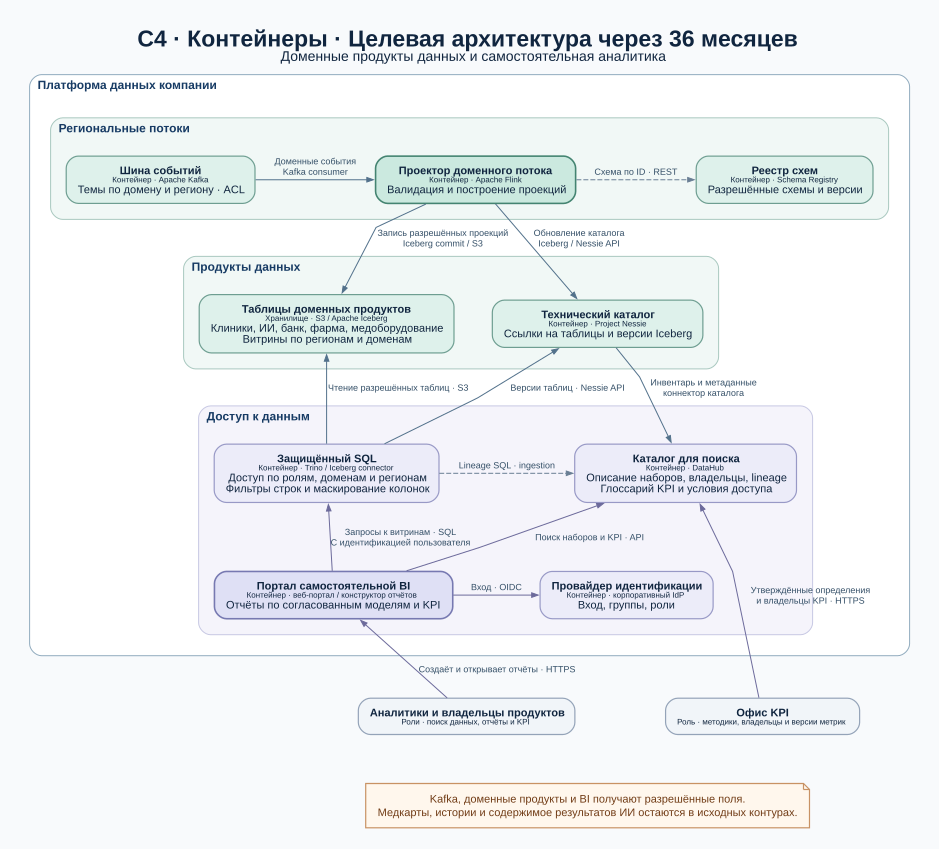
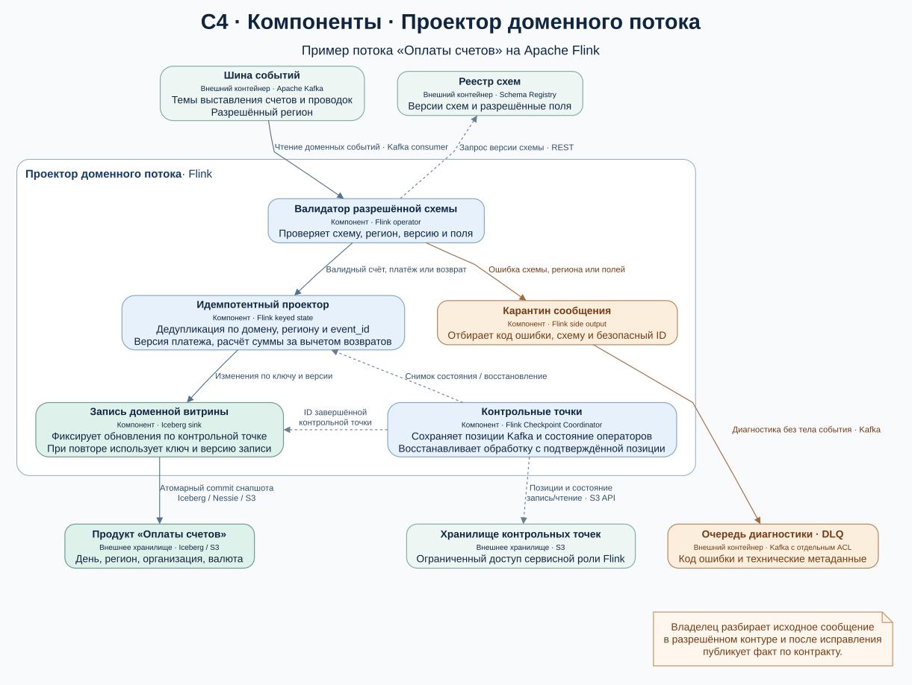

# Task3Advanced. Целевая архитектура и риски

Горизонт решения — три года. Клиники, банк и ИИ-подразделение самостоятельно публикуют продукты данных. Для фармы и производителя медицинского оборудования предусмотрено подключение через адаптеры. Сотрудники выбирают доступные показатели в портале и конструируют отчёты. Медкарты, истории болезни и результаты исследований остаются в закрытых операционных системах.

## Материалы

- [Целевая архитектура и переход](architecture.md) — от выставления счёта до отчёта, межрегиональные границы, надёжность и условия вывода легаси.
- [Карта рисков](risks.md) и [план управления](risk-management.md) — оценки, владельцы, предотвращение и восстановление.

Схемы можно просматривать в README. Для редактирования скачайте соответствующий файл `.drawio` и откройте его в draw.io.

## C4. Контейнеры

Два представления уровня C2 показывают одно целевое состояние. Первое описывает источники событий и границы операционных систем, второе — использование разрешённых данных сотрудниками.

[Открыть крупно](diagrams/c4-l2-operational.svg) · [Исходник draw.io](diagrams/c4-l2-operational.drawio)

[Открыть крупно](diagrams/c4-l2-analytics.svg) · [Исходник draw.io](diagrams/c4-l2-analytics.drawio)

## C4. Компоненты

Детализация потокового обработчика показывает проверку схемы, дедупликацию, запись результата и обработку ошибок.

[Открыть крупно](diagrams/c4-l3-domain-stream-projector.svg) · [Исходник draw.io](diagrams/c4-l3-domain-stream-projector.drawio)

## Как проверить

1. На C2 проследить путь банковского платежа и действие пользователя в портале. Для каждого перехода определить, кто публикует данные, кто их читает и где действуют ограничения доступа.
2. Найти на C2 потоковый обработчик и раскрыть тот же контейнер на C3. Проследить повторное сообщение, сбой после записи и сообщение с запрещённым полем. Затем сверить ожидаемый итог отчёта с критерием приёмки пилота.
3. Проверить в плане перехода контрольные точки через два месяца, год и три года. На последней критичные операции продолжаются при отключении старой шины и DWH.
4. Выбрать риск из карты и по его ID найти владельца, действие при срабатывании и проверяемый результат в плане управления. Схемы SVG открываются в браузере.
