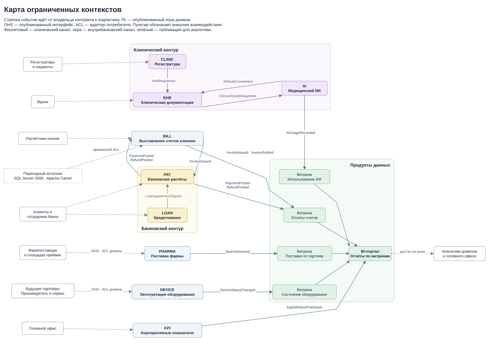
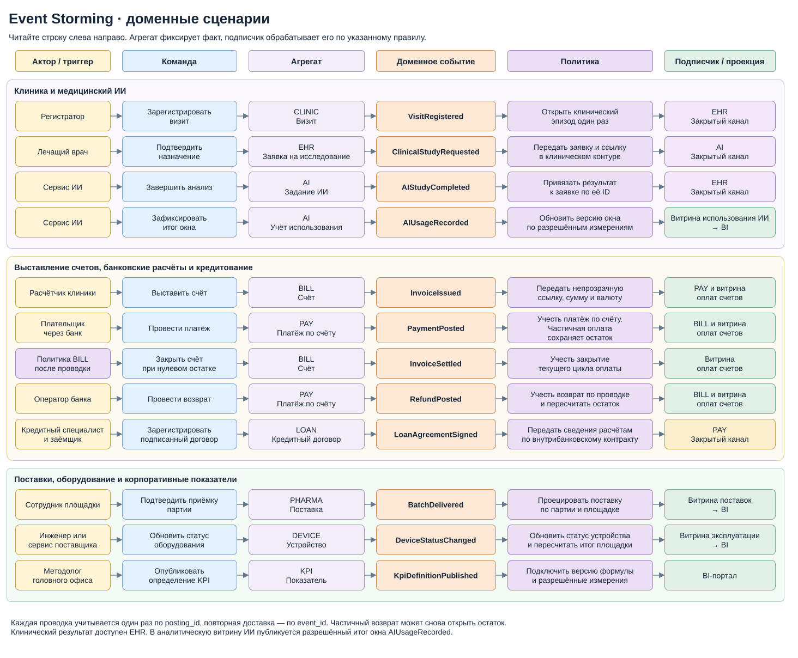

# Task4Advanced. Домены и события

Клиника выставляет счёт, банк проводит оплату, а владелец аналитического продукта публикует согласованную сумму. У этих действий разные владельцы и транзакционные границы. Диаграммы и каталоги ниже описывают, как связаны эти действия и какие данные получает каждый участник.

## Материалы

- [Карта bounded contexts](bounded-contexts.svg) · [исходник](bounded-contexts.dot). Границы сервисов, отношения поставщика и потребителя и адаптеры для партнёров.
- [Event Storming](event-storming.svg) · [исходник](event-storming.dot). Путь от решения участника до события и реакции подписчика.
- [Агрегаты](aggregates.md) — ключи и правила, которые должны выполняться в одной транзакции.
- [Каталог событий](events.md) — источник, смысл, разрешённые получатели и минимальный контракт.
- [Обоснование](justification.md) — последствия перехода с интеграций через SQL Server и Camel, условия для синхронных операций и критерии перехода.

## Как проверить

1. Найти `InvoiceIssued` на событийной схеме. Сверить имя источника и получателей с каталогом событий. Найти агрегат счёта и проверить его ключ и инварианты.
2. Повторить пример из каталога агрегатов: для счёта на 10 000 ₽ провести 6 000 ₽ и 4 000 ₽ с разными ID платежа. Повтор первой проводки оставляет итог 10 000 ₽. После подтверждённого возврата 2 000 ₽ чистая оплата — 8 000 ₽, неоплаченный остаток — 2 000 ₽. Доплата 2 000 ₽ закрывает второй цикл. Сверить реакцию клиники с условиями публикации `InvoiceSettled`.
3. Проследить `ClinicalStudyRequested` и `AIStudyCompleted`. Их подписчики находятся в закрытом медицинском контуре; аналитический продукт получает отдельный `AIUsageRecorded`. Сопоставить границу с [целевой архитектурой](../Task3Advanced/architecture.md).
4. На примере поставки фармкомпании проверить, кто переводит контракт партнёра, какой агрегат фиксирует изменение и кто публикует набор для сотрудников. Открыть схемы можно прямо на GitHub.
