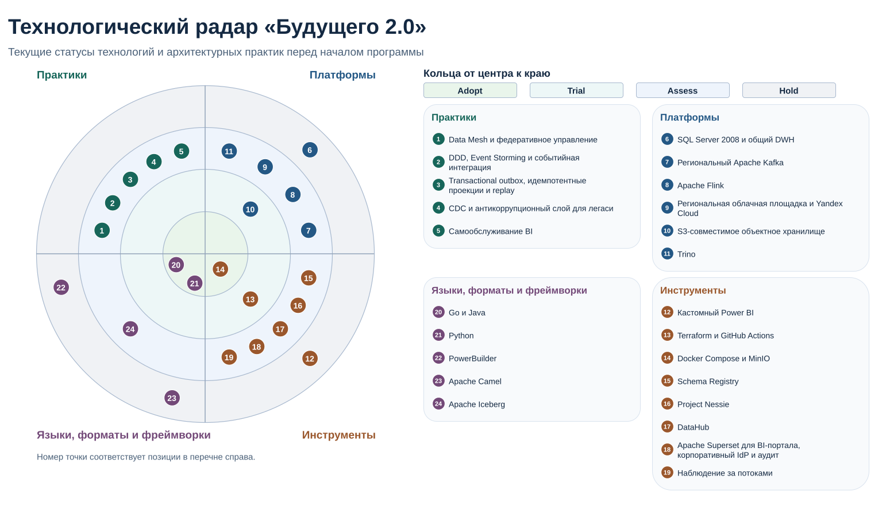

# Task5Advanced. Технологический стек, стоимость и внедрение Data Mesh

Решение связывает три вопроса руководства: какие технологии уже можно использовать, сколько стоит переход при росте объёма данных и когда домены смогут выпускать собственные витрины.

**Решение для пилота.** В базовом сценарии трёхлетний TCO снижается с 370,83 до 343,87 млн ₽. Эффект включает оценку 17 928 высвобожденных часов аналитиков. Без денежной оценки этих часов целевой вариант дороже на 1,73 млн ₽. Поэтому до расширения пилота нужно замерить фактические трудозатраты и подтвердить сроки отключения старых систем.

## Материалы

- [Расширенный технический радар](tech-radar.md) · [Исходник draw.io](tech-radar.drawio). В перечне для каждой позиции указан статус, владелец и условие следующего пересмотра.
- [Расчёт TCO и интерпретация](tco-analysis.md) · [редактируемая модель Excel](tco-analysis.xlsx). Сравнение трёх лет эксплуатации существующей и целевой архитектуры с учётом переходного периода. Входные допущения отделены от расчётов.
- [Стратегический роадмап](roadmap.md) — ответственность доменов и платформы, пилот оплат, запуск самообслуживания за год и поддержка регионального масштабирования.

[Открыть радар крупно](tech-radar.svg)

## Как проверить

1. Выбрать технологию или паттерн, например Data Mesh. Найти её статус, владельца и проверку, после которой статус можно изменить. Сверить срок проверки с волной роадмапа.
2. Открыть `tco-analysis.xlsx` в табличном редакторе. На листе `TCO` сверить итоги в `E6:E8` с расчётом в Markdown. В копии книги поставить `25%` в `B14` при нулевой поправке ко времени аналитиков в `B15`. Значение в `E8` должно снизиться с 26,96 до 21,45 млн ₽. Источники ставок и пример получения сумм за первый год приведены в [пояснении к TCO](tco-analysis.md#как-получаются-суммы).
3. Проследить путь витрины оплат от пилота до эксплуатации: кто согласует формулу, кто строит поток, кто принимает отчёт, как измеряются задержка и сверка с банком. Названия контекстов и событий можно сверить с [Task4](../Task4Advanced/events.md).
4. Проверить три контрольных срока из кейса: согласованная архитектура к М2, самостоятельное построение отчётов к М12, событийная платформа и выход в новые регионы к М36. Остаточные риски и способы реакции перечислены в [Task3](../Task3Advanced/risk-management.md).
